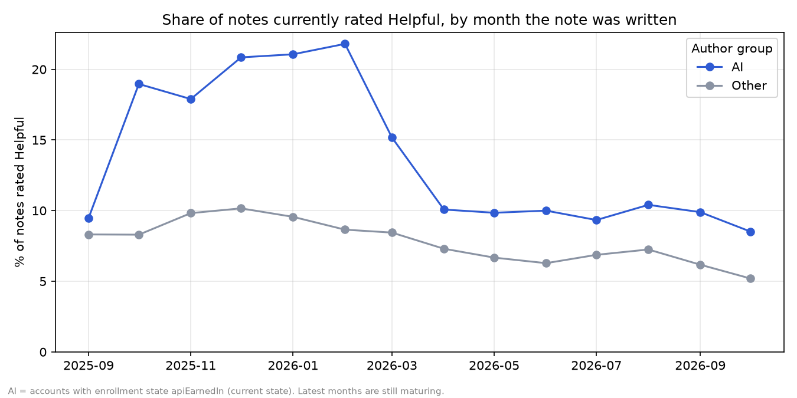

# NoteScope

Do AI-written Community Notes on X reach "Helpful" status more often and faster than human-written ones?

> Status: v0 (descriptive analysis, Oct 2026). Next: v0.1 with survival analysis and rating-level data.

## Business question
X publishes its Community Notes data openly. Some notes are written by AI note writers, others by humans.
NoteScope compares the two: how often notes become "Helpful", and how long it takes.

## Method
- Data: X Community Notes open data (notes, note status history, user enrollment)
- Tools: Python, SQL (DuckDB), pandas, matplotlib
- Pipeline: download -> load into DuckDB -> SQL metrics -> charts

## Findings
Data snapshot: 3.19M notes, 3.40M note-status records, 39 AI writer accounts (enrollment state `apiEarnedIn`), 331k AI notes vs 3.07M other notes. Comparison window: from the first AI note (Sep 2025) onward.



1. **AI notes are rated Helpful more often than other notes in every month since Sep 2025** (14 of 14 months). Over all time: 10.7% of AI notes vs 8.2% of other notes are currently Helpful. The AI notes' share of "Not Helpful" is lower too (1.0% vs 4.4%).
2. **The gap has narrowed.** In Oct 2025 to Feb 2026 AI notes reached about 18-22% Helpful against 8-10% for other notes. Since Apr 2026, when AI note volume jumped (7k notes in Feb to 37k in Apr and 44-54k per month after), the rates are about 9-10% vs 5-7%.
3. **Speed to Helpful is about the same.** Median time from writing to first Helpful status is 8.5 hours for AI notes and 8.1 hours for other notes (90th percentile 55 vs 51 hours). AI notes reach "Not Helpful" faster at the median (2.4 vs 3.3 hours) but slower in the tail (33.5 vs 23.3 hours at the 90th percentile).
4. **Most notes in both groups are still undecided** (about 88% "Needs More Ratings").

Queries: `sql/01_overview.sql` to `sql/04_data_quality.sql`. Figures: `python scripts/make_figures.py`.

## Recommendations
- Treat the Helpful-rate advantage of AI notes as real but shrinking, and monitor it as AI volume grows: quality per note may fall as volume rises.
- Compare AI and human notes on the same tweets (matched design) before drawing causal conclusions. The groups may choose different posts.
- For speed, report time to first Helpful status together with the share of notes that never leave "Needs More Ratings", since the timing statistic only covers decided notes.

## Limitations
- **Descriptive, not causal.** AI and human writers may pick different tweets, topics and moments. Nothing here controls for that.
- **AI group is defined by current account state.** `apiEarnedIn` is the enrollment state at the time of the data snapshot, not at writing time. Accounts that lost or never earned that status are not counted as AI.
- **Current status only.** The Helpful share uses each note's status now. A note that was Helpful and later lost the status counts as not Helpful.
- **Recent months are immature.** Newer notes have had less time to collect ratings, so the latest months look lower for both groups.
- **Timing covers decided notes only.** Hours to first non-"Needs More Ratings" status exist only for notes that left that state.
- **Incomplete joins.** 13% of status records have no row in the notes files (likely deleted notes), and 5% of status records come from authors missing in the enrollment file. The latter are counted as "Other".
- **Data lag.** The public files are daily snapshots published with a delay of about 48 hours.

## Data availability and terms
- **Source:** the public Community Notes data from X's "Download data" page (notes, note status history, user enrollment). It is used under the X Developer Agreement and Policy.
- **No raw data in this repo.** Note texts and the raw or processed tables are not published here (see `.gitignore`). To reproduce the analysis, download the files yourself from the page above and point the scripts to your local data folder.
- **Aggregate analysis only.** Results are reported in aggregate. Participant IDs are pseudonymous and are not used to profile individuals.
- **Purpose:** non-commercial research linked to an MSc thesis (UCD, Social Data Science). The project studies the socio-technical dynamics of crowd-sourced verification (consensus and bridging patterns in Community Notes). It does not aim to detect or benchmark rule violations on X.
- **Example notes:** if note texts are shown in reports, they are few, unmodified and attributed as X's display requirements ask.

## Project structure
```
data/raw/        downloaded source files (not tracked by git)
data/processed/  DuckDB database and cleaned tables (not tracked)
sql/             SQL queries
src/notescope/   reusable Python code
notebooks/       exploration
reports/figures/ charts used in the README
scripts/         load_data.py, run_sql.py, make_figures.py, check_setup.py
```

## How to run
```bash
python3 -m venv .venv
source .venv/bin/activate
pip install -r requirements.txt
python scripts/check_setup.py

# point to the folder with the downloaded Community Notes TSV files (default: ~/Desktop/Thesis/Community Notes)
export NOTESCOPE_DATA_DIR="/path/to/Community Notes"
python scripts/load_data.py
python scripts/run_sql.py sql/01_overview.sql
python scripts/make_figures.py   # writes charts to reports/figures/
```
